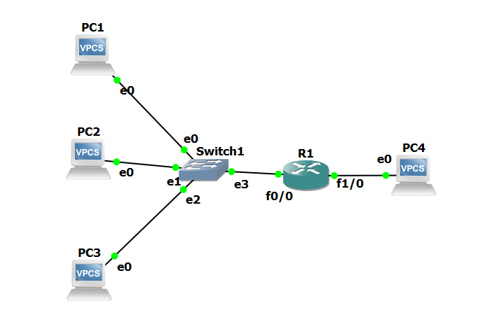

[English](README.md) | ภาษาไทย

# NAT และ DHCP บน Cisco Router (GNS3)

ตั้งค่า static NAT, PAT, dynamic NAT และ DHCP server บน Cisco 7200 ตัวเดียว แต่ละส่วนตรวจสอบด้วยคำสั่ง `show` และด้วย packet capture ทั้งสองฝั่งของ router

> Lab ทำคนเดียว สร้างใน GNS3 (ต.ค. 2026) Router: Cisco 7200, IOS 15.2 Host: VPCS

## Topology



| อุปกรณ์ | Interface | Address | หน้าที่ |
|---|---|---|---|
| R1 | FastEthernet0/0 | 192.168.10.1/24 | NAT inside, DHCP server |
| R1 | FastEthernet1/0 | 203.0.113.1/24 | NAT outside |
| PC1, PC2, PC3 | e0 | 192.168.10.2, .3, .4 (static), ต่อมาเป็น .11+ (DHCP) | Host ฝั่ง inside |
| PC4 | e0 | 203.0.113.3/24, **ไม่มี default gateway** | Host ฝั่ง outside |

PC4 ไม่มี gateway โดยตั้งใจ เพราะใช้แทน host บน Internet ซึ่งไม่มี route กลับไปหา private address ถ้าไม่มี NAT ตัว reply ที่จะกลับไปยัง network ฝั่ง inside จะกลับไม่ได้

## สรุปผลโดยย่อ

| ขั้นตอน | การทดสอบ | ผลลัพธ์ |
|---|---|---|
| Baseline | PC1 → PC4, ไม่มี NAT | ไม่ผ่าน Request ไปถึง PC4 แต่ไม่มี reply กลับมา |
| Static NAT | PC1 → PC4 | ผ่าน Source เปลี่ยนเป็น 203.0.113.10 |
| Static NAT | PC2 → PC4 | ไม่ผ่าน PC2 ไม่มี mapping จึงออกไปโดยไม่ถูกแปล address |
| Static NAT | PC4 → 203.0.113.10 | ผ่านและไปถึง PC1 Static NAT ทำงานได้สองทาง |
| PAT | PC1 และ PC2 → PC4 พร้อมกัน | ผ่านทั้งคู่ โดยใช้ address เดียวคือ 203.0.113.1 |
| Dynamic NAT | PC1, PC2, PC3 → PC4 โดย pool มี 2 address | PC1 และ PC2 ผ่าน PC3 ได้ "Destination host unreachable" |
| DHCP | PC1, PC2, PC3 ขอ address | ได้ .11, .12, .13 และ renew lease ทุก ~62 s |
| DHCP + PAT | PC1 (192.168.10.11 จาก DHCP) → PC4 | ผ่าน Source ฝั่ง outside คือ 203.0.113.1 |

## 1. Baseline: ทำไมต้องมี NAT

PC1 ping gateway ของตัวเองได้ แต่ ping PC4 ไม่ได้ Capture ฝั่ง outside แสดงว่า echo request ทั้งห้าครั้งไปถึง PC4 ด้วย source 192.168.10.2 แต่ไม่มี reply เลย

ขาไปไม่มีปัญหา เพราะทั้งสอง network ต่อตรงกับ R1 ปัญหาอยู่ที่ขากลับ PC4 เห็น source address ที่อยู่นอก subnet ของตัวเอง และไม่มี gateway ให้ส่ง reply ออกไป

ไฟล์: [`outputs/00_baseline.txt`](outputs/00_baseline.txt), [`pcaps/00_baseline_outside.pcapng`](pcaps/00_baseline_outside.pcapng)

## 2. Static NAT

```
ip nat inside source static 192.168.10.2 203.0.113.10
```

```
R1#show ip nat translations
Pro Inside global      Inside local       Outside local      Outside global
--- 203.0.113.10       192.168.10.2       ---                ---
```

Config ของ PC4 ไม่ได้เปลี่ยน สิ่งที่เปลี่ยนคือ source address ที่ PC4 เห็น 203.0.113.10 อยู่ใน subnet เดียวกับ PC4 จึง reply กลับได้โดยตรง แล้ว R1 แปล destination กลับเป็น 192.168.10.2

PC2 ยังไม่ผ่าน เพราะ packet ของ PC2 ออกจาก R1 ด้วย source 192.168.10.3 จึงเจอปัญหาเดียวกับ baseline

**R1 ตอบ ARP แทน NAT address** เมื่อ PC4 ping 203.0.113.10 จะส่ง ARP request หา address นี้ก่อน R1 ตอบกลับด้วย MAC ของตัวเอง ทั้งที่ 203.0.113.10 ไม่ได้ตั้งไว้บน interface ไหนเลย ถ้าไม่มี reply นี้ PC4 จะสร้าง frame ไม่ได้

ไฟล์: [`outputs/01_static_nat.txt`](outputs/01_static_nat.txt) (มี `debug ip nat` ด้วย), [`pcaps/01_static_inside.pcapng`](pcaps/01_static_inside.pcapng), [`pcaps/01_static_outside.pcapng`](pcaps/01_static_outside.pcapng)

## 3. PAT (overload)

```
access-list 1 permit 192.168.10.0 0.0.0.255
ip nat inside source list 1 interface FastEthernet1/0 overload
```

PC1 และ PC2 ส่ง ping คนละ 20 ครั้งพร้อมกัน ผ่านทั้งหมด Capture ฝั่ง outside มี source address เพียงตัวเดียวคือ 203.0.113.1

**R1 เปลี่ยน ICMP identifier ที่ซ้ำกัน** บังเอิญทั้งสอง host ใช้ ICMP ID เดียวกัน R1 จึงกำหนด ID ที่ไม่ซ้ำให้แต่ละตัวบนฝั่ง outside:

| Host | Inside local | Inside global |
|---|---|---|
| PC1 | 192.168.10.2:1927 | 203.0.113.1:1027 |
| PC2 | 192.168.10.3:1927 | 203.0.113.1:1026 |

ถ้า R1 ใช้ ID 1927 กับทั้งคู่ reply ที่ส่งมาหา 203.0.113.1 ด้วย ID 1927 จะตรงกับสอง entry ในตาราง และ R1 จะส่งต่อได้แค่ host เดียว

**UDP ใช้ port number ในแบบเดียวกัน:**

| Host | Inside local | Inside global |
|---|---|---|
| PC1 | 192.168.10.2:54057 | 203.0.113.1:4502 |
| PC2 | 192.168.10.3:23297 | 203.0.113.1:4501 |

การทดสอบ UDP ส่งไปที่ destination port 7 ซึ่งเป็นค่า default ของ VPCS

ไฟล์: [`configs/R1_pat.cfg`](configs/R1_pat.cfg), [`outputs/02_pat.txt`](outputs/02_pat.txt), [`pcaps/02_pat_inside.pcapng`](pcaps/02_pat_inside.pcapng), [`pcaps/02_pat_outside.pcapng`](pcaps/02_pat_outside.pcapng)

## 4. Dynamic NAT และ pool ที่ใช้หมด

```
ip nat pool PUBLIC 203.0.113.20 203.0.113.21 netmask 255.255.255.0
ip nat inside source list 1 pool PUBLIC
```

Pool มี 2 address แต่มี host ฝั่ง inside 3 เครื่อง

| ลำดับ | Host | ผลลัพธ์ | Address ที่ใช้ |
|---|---|---|---|
| 1 | PC1 | ผ่าน | 203.0.113.20 |
| 2 | PC2 | ผ่าน | 203.0.113.21 |
| 3 | PC3 | Destination host unreachable จาก 192.168.10.1 | ไม่เหลือ |
| 4 | PC3 หลังสั่ง `clear ip nat translation *` | ผ่าน | 203.0.113.20 |

ตัวอย่างบางส่วน:

```
R1#show ip nat statistics
 pool PUBLIC: netmask 255.255.255.0
        start 203.0.113.20 end 203.0.113.21
        type generic, total addresses 2, allocated 2 (100%), misses 20
```

Capture ให้ผลตรงกัน ฝั่ง inside R1 ส่ง ICMP unreachable กลับไปหา PC3 ทุกครั้งที่มี request ส่วนฝั่ง outside ไม่มี packet จาก PC3 ออกไปเลย

**Timeout ต่างจาก unreachable อย่างไร** ตอน static NAT PC2 ได้ timeout คือ packet ออกจาก router ไปแล้วแต่ไม่มีใครตอบ ส่วน PC3 ในกรณีนี้ได้ unreachable จาก R1 โดยตรง คือ router เป็นคน drop packet เอง ข้อความ unreachable จึงบอกได้ว่าควรเริ่มตรวจที่อุปกรณ์ไหน

ใน network จริง วิธีแก้คือเพิ่ม `overload` ให้ pool เพื่อให้ public address แต่ละตัวรองรับได้หลาย host โดยแยกกันด้วย port

ไฟล์: [`configs/R1_dynamic_nat.cfg`](configs/R1_dynamic_nat.cfg), [`outputs/03_dynamic_nat.txt`](outputs/03_dynamic_nat.txt), [`pcaps/03_dynamic_inside.pcapng`](pcaps/03_dynamic_inside.pcapng), [`pcaps/03_dynamic_outside.pcapng`](pcaps/03_dynamic_outside.pcapng)

## 5. DHCP server

```
ip dhcp excluded-address 192.168.10.1 192.168.10.10
ip dhcp pool LAN_POOL
 network 192.168.10.0 255.255.255.0
 default-router 192.168.10.1
 lease 0 0 2
```

ตัวอย่างบางส่วน:

```
R1#show ip dhcp binding
192.168.10.11   0100.5079.6668.00       Oct 02 2026 11:29 AM    Automatic  Active     FastEthernet0/0
192.168.10.12   0100.5079.6668.01       Oct 02 2026 11:29 AM    Automatic  Active     FastEthernet0/0
192.168.10.13   0100.5079.6668.02       Oct 02 2026 11:29 AM    Automatic  Active     FastEthernet0/0
```

Address แรกที่แจกคือ .11 เพราะ .1 ถึง .10 ถูก exclude ไว้ Address บนแต่ละ host, binding table ของ router และ capture ตรงกันทั้งหมด

**DORA ใน capture (PC1):**

| Message | Source → Destination |
|---|---|
| Discover | 0.0.0.0 → 255.255.255.255 |
| Offer | 192.168.10.1 → 192.168.10.11 |
| Request | 0.0.0.0 → 255.255.255.255 |
| ACK | 192.168.10.1 → 192.168.10.11 |

Client ส่งจาก 0.0.0.0 เพราะยังไม่มี address และส่งแบบ broadcast เพราะยังไม่รู้ว่า server อยู่ที่ไหน

**สิ่งอื่นที่เห็นใน capture:**

- Lease ยาว 120 s โดยมี renewal time (T1) 60 s และ rebinding time (T2) 105 s ทุก host renew ประมาณทุก 62 s ซึ่งตรงกับ T1
- R1 ส่ง ARP request หา address นั้นก่อนจะ offer ออกไป และ Offer ตามมาประมาณ 2 s หลัง Discover แรก ระหว่างรอ client ส่ง Discover ครั้งที่สอง
- หลังได้ ACK แต่ละ client ส่ง ARP request สามครั้งหา address ใหม่ของตัวเอง
- คำสั่ง `ip dhcp -x` บน PC3 ส่ง DHCP Release แล้ว entry ของ PC3 ก็หายไปจาก binding table
- VPCS ส่ง Request ตอน renew เป็น broadcast จาก 0.0.0.0

ไฟล์: [`outputs/04_dhcp.txt`](outputs/04_dhcp.txt), [`pcaps/04_dhcp_inside.pcapng`](pcaps/04_dhcp_inside.pcapng)

## 6. Configuration สุดท้าย: DHCP + PAT

Configuration สุดท้ายรวมทั้งสองอย่างเข้าด้วยกัน host ฝั่ง inside ได้ address จาก DHCP และออกไปฝั่ง outside ผ่าน public address เพียงตัวเดียว

```
icmp 203.0.113.1:1024  192.168.10.11:28055 203.0.113.3:28055 203.0.113.3:1024
```

ไฟล์: [`configs/R1_final_dhcp_pat.cfg`](configs/R1_final_dhcp_pat.cfg), [`outputs/05_dhcp_with_pat.txt`](outputs/05_dhcp_with_pat.txt), [`pcaps/05_dhcp_pat_inside.pcapng`](pcaps/05_dhcp_pat_inside.pcapng), [`pcaps/05_dhcp_pat_outside.pcapng`](pcaps/05_dhcp_pat_outside.pcapng)

## ปัญหาที่เจอระหว่างทำ

**VPCS อ่าน subnet mask เป็น gateway** ผมตั้ง PC4 ด้วย `ip 203.0.113.3 255.255.255.0` แล้ว VPCS เก็บ 255.255.255.0 เป็น default gateway Capture baseline ครั้งแรกจึงเห็น PC4 ส่ง ARP request หา 255.255.255.0 ผมแก้ด้วย `ip 203.0.113.3/24` และเช็กด้วย `show ip` ว่า gateway เป็น 0.0.0.0 ตอนนี้ผมสั่ง `show ip` ทุกครั้งหลังเปลี่ยน address

**ชื่อ interface ไม่ตรงกับที่วางแผนไว้** 7200 ไม่มี FastEthernet0/1 ส่วน port adapter ใน slot 1 คือ FastEthernet1/0 คำสั่ง `show ip interface brief` บอกชื่อจริงให้

**Option ของคำสั่ง ping ใน VPCS แยกตัวพิมพ์เล็กใหญ่** `-P` ใช้เลือก protocol ส่วน `-p` ใช้กำหนด destination port ตอนทดสอบ UDP ครั้งแรกผมใช้ `-p 17` จึงยังส่งเป็น ICMP อยู่ ผมสังเกตได้เพราะ output แสดง `icmp_seq`

## โครงสร้าง Repository

```
nat-dhcp/
  topology.png
  nat-dhcp.gns3        GNS3 project file (no IOS image included)
  configs/             show running-config at each stage
  outputs/             ping results and show/debug output, in test order
  pcaps/               captures on the inside and outside links
```

ไม่ได้เก็บ running-config เต็มของขั้น static NAT ไว้ ไฟล์ [`configs/static_nat_commands.txt`](configs/static_nat_commands.txt) แสดงคำสั่งที่เพิ่มต่อจาก base config
