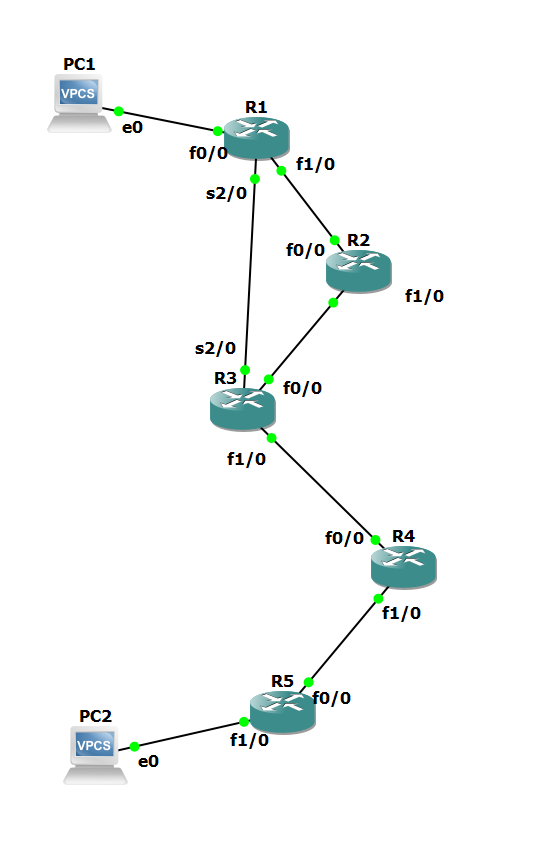
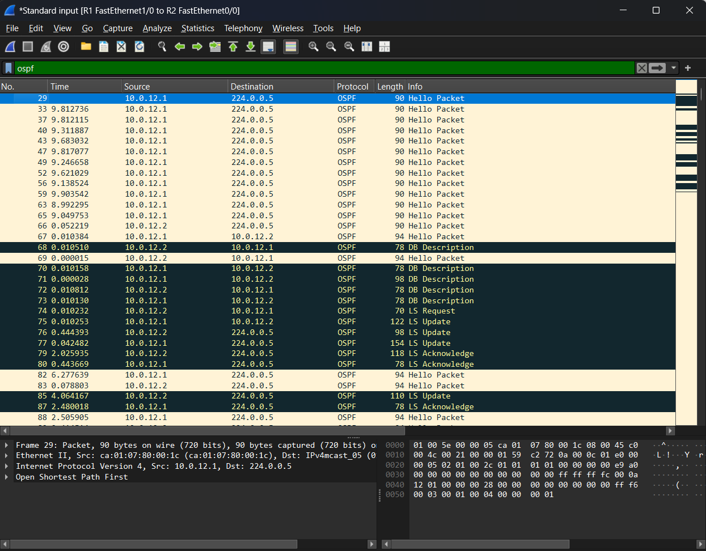

[English](README.md) | ภาษาไทย

# OSPF: Single Area, Link Failure, Multi-Area และ Virtual Link (GNS3)

Router Cisco 7200 ห้าตัวรัน OSPF Lab นี้วัดว่า traffic หยุดไปนานเท่าไรเมื่อเกิด link failure สามแบบ จากนั้นแบ่ง network เป็นหลาย area แบบที่ทำให้ network ใช้งานไม่ได้ แล้วซ่อมด้วย virtual link ทุกผลลัพธ์มี output ของคำสั่ง `show` และ packet capture ยืนยัน

> Lab ทำคนเดียว สร้างใน GNS3 (ต.ค. 2026) Router: Cisco 7200, IOS 15.2 Host: VPCS

## Topology



| Link | Network | Address | OSPF cost | Area (ส่วนที่ 4 และ 5) |
|---|---|---|---|---|
| PC1 – R1 f0/0 | 192.168.1.0/24 | PC1 .10, R1 .1 | 1 | 0 |
| R1 f1/0 – R2 f0/0 | 10.0.12.0/30 | R1 .1, R2 .2 | 1 | 0 |
| R2 f1/0 – R3 f0/0 | 10.0.23.0/30 | R2 .1, R3 .2 | 1 | 0 |
| R1 s2/0 – R3 s2/0 | 10.0.13.0/30 | R1 .1, R3 .2 | 64 | 0 |
| R3 f1/0 – R4 f0/0 | 10.1.34.0/30 | R3 .1, R4 .2 | 1 | 1 |
| R4 f1/0 – R5 f0/0 | 10.2.45.0/30 | R4 .1, R5 .2 | 1 | 2 |
| R5 f1/0 – PC2 | 192.168.5.0/24 | R5 .1, PC2 .10 | 1 | 2 |

Router ID คือ 1.1.1.1 ถึง 5.5.5.5 Serial link ระหว่าง R1 กับ R3 เป็นเส้นทางสำรอง จำนวน hop น้อยกว่า แต่มี cost 64

## สรุปผลลัพธ์

| ส่วน | การทดสอบ | ผลลัพธ์ |
|---|---|---|
| 1 | PC1 → PC2 ก่อนเปิด OSPF | ได้ Destination host unreachable จาก R1 |
| 2 | OSPF แบบ single area | PC1 → PC2 ใช้งานได้ ผ่าน R2 ด้วย cost 5 ไม่ใช้เส้นทาง serial (cost 67) |
| 3a | `shutdown` ที่ R1 f1/0 | Traffic หยุด 7.06 s, ping หาย 3 ครั้ง |
| 3b | Suspend link แต่ interface ยัง up | Traffic หยุด 41.08 s, ping หาย 20 ครั้ง |
| 3c | Failure แบบเดียวกัน ตั้ง Hello 1 s, Dead 4 s | Traffic หยุด 11.06 s, ping หาย 5 ครั้ง |
| 4 | Area 0, 1 และ 2 ต่อกันเป็นสาย | Neighbor ทุกตัว FULL แต่ PC1 ไปถึง PC2 ไม่ได้ Area 2 ถูกตัดขาด |
| 5 | Virtual link R3–R4 ผ่าน area 1 | PC1 → PC2 กลับมาใช้งานได้ R4 กลายเป็น area border router |

## 1. Baseline

ทุก interface up และ R1 ping neighbor ทั้งสองตัวได้ PC1 ไปถึง PC2 ไม่ได้ และคำตอบมาจาก gateway ของตัวเอง:

```
PC1> ping 192.168.5.10
*192.168.1.1 icmp_seq=1 ttl=255 time=9.316 ms (ICMP type:3, code:1, Destination host unreachable)
```

R1 ไม่มี route ไป 192.168.5.0/24 จึงทิ้ง packet แล้วแจ้งกลับมา ซึ่งต่างจาก timeout ที่ packet ออกไปแล้วไม่มีอะไรตอบกลับ

ไฟล์: [`outputs/00_base.txt`](outputs/00_base.txt)

## 2. OSPF แบบ single area

ทุก network อยู่ใน area 0 ส่วน interface ฝั่ง LAN ทั้งสองตั้งเป็น passive

ตัวอย่าง output:

```
R1#show ip ospf neighbor
Neighbor ID     Pri   State           Dead Time   Address         Interface
3.3.3.3           0   FULL/  -        00:00:34    10.0.13.2       Serial2/0
2.2.2.2           1   FULL/BDR        00:00:39    10.0.12.2       FastEthernet1/0

R1#show ip route ospf
O        10.0.23.0/30 [110/2] via 10.0.12.2, 00:11:55, FastEthernet1/0
O        10.1.34.0/30 [110/3] via 10.0.12.2, 00:10:24, FastEthernet1/0
O        10.2.45.0/30 [110/4] via 10.0.12.2, 00:09:28, FastEthernet1/0
O     192.168.5.0/24 [110/5] via 10.0.12.2, 00:08:31, FastEthernet1/0
```

**การเลือกเส้นทางดูจาก cost ไม่ใช่จำนวน hop** เส้นทางไป 192.168.5.0/24 ผ่าน R2 ข้าม FastEthernet link ห้าเส้น: 1 + 1 + 1 + 1 + 1 = 5 เส้นทางผ่าน serial link มี router น้อยกว่าหนึ่งตัว แต่ cost เป็น 64 + 1 + 1 + 1 = 67 OSPF จึงเลือกเส้นทาง cost 5 และ `trace` จาก PC1 ยืนยันผลนี้ (R1, R2, R3, R4, R5)

**Router ทุกตัวใน area มี database เหมือนกัน** `show ip ospf database` บน R1 และบน R3 แสดง Router LSA 5 รายการ และ Network LSA 4 รายการ โดย sequence number และ checksum ตรงกันทุกตัว

**Serial link ไม่มี DR** Neighbor ฝั่ง serial แสดง `FULL/ -` เพราะ link แบบ point-to-point มี router แค่สองตัว จึงไม่มีการเลือก DR ส่วน Ethernet link แต่ละเส้นจะเลือก DR หนึ่งตัวและสร้าง Network LSA หนึ่งรายการ

### Adjacency ใน capture



Capture บน link R1–R2 ขณะเปิดใช้ OSPF:

| เวลา | เหตุการณ์ |
|---|---|
| 0 s | R1 ส่ง Hello แรก ช่อง DR เป็น 0.0.0.0 |
| +48 s | Wait timer (40 s) หมดลงโดยไม่มี router อื่นบน link Hello ถัดไปของ R1 ระบุตัวเองเป็น DR |
| +104.4 s | R2 ส่ง Hello แรก R1 ตอบทันทีด้วย Hello แบบ unicast |
| +104.5 s | Database Description packet ตามด้วย LS Request และ LS Update การแลกเปลี่ยนใช้เวลาประมาณ 0.07 s |
| +107 s | LS Acknowledge จาก router ทั้งสองตัว |

R1 ได้เป็น DR เพราะอยู่บน link ตัวเดียวตอน Wait timer หมด ไม่ได้มาจาก priority หรือ router ID ทั้งที่ R2 มี router ID สูงกว่า ก็ยังได้เป็นแค่ BDR

**การเลือก DR ไม่เป็นแบบ preemptive** ผมเห็นเรื่องนี้สองครั้ง:

- หลัง `clear ip ospf process` บน R2 R1 ยังเป็น DR บน link R1–R2 เหมือนเดิม ส่วนบน link R2–R3 R3 ขยับจาก BDR ขึ้นเป็น DR และ R2 กลับมาเป็น BDR
- หลังส่วนที่ 3a ที่ interface ของ R1 down แล้วกลับมา R2 เป็น DR บน link R1–R2 และ R1 เป็น BDR

Router ที่หลุดไปแล้วกลับมา จะไม่ได้บทบาทเดิมคืน

ไฟล์: [`configs/1_single_area/`](configs/1_single_area/), [`outputs/01_single_area.txt`](outputs/01_single_area.txt), [`pcaps/01_adjacency_R1-R2.pcapng`](pcaps/01_adjacency_R1-R2.pcapng), [`pcaps/01_clear_process_R1-R2.pcapng`](pcaps/01_clear_process_R1-R2.pcapng)

## 3. Link failure และ convergence

PC1 ping PC2 ต่อเนื่องระหว่างที่ link R1–R2 เสีย ผม capture บน link ของ PC1 และบน serial link พร้อมกัน Downtime คือช่วงห่างระหว่าง echo reply ตัวสุดท้ายก่อน failure กับตัวแรกหลัง failure

| กรณี | Link เสียแบบไหน | Hello / Dead | เวลาที่ใช้ตรวจพบ | ตรวจพบ → traffic กลับมา | Downtime | Ping ที่หาย |
|---|---|---|---|---|---|---|
| 3a | `shutdown` ที่ R1 f1/0 | 10 s / 40 s | 0.7 s | 6.3 s | **7.06 s** | 3 |
| 3b | Suspend link ใน GNS3 | 10 s / 40 s | 35.0 s | 6.1 s | **41.08 s** | 20 |
| 3c | Suspend link ใน GNS3 | 1 s / 4 s | 4.6 s | 6.5 s | **11.06 s** | 5 |

"เวลาที่ใช้ตรวจพบ" นับถึงตอนที่ R1 flood Router LSA ใหม่ออกบน serial link VPCS รอ 2 s ต่อ ping ที่หายแต่ละครั้ง ตัวเลขทั้งหมดจึงคลาดเคลื่อนได้ประมาณ 2 s

ทั้งสามกรณี route เปลี่ยนแบบเดียวกัน:

```
R1#show ip route 192.168.5.0
  Known via "ospf 1", distance 110, metric 67, type intra area
  * 10.0.13.2, from 5.5.5.5, 00:01:25 ago, via Serial2/0
```

Metric เปลี่ยนจาก 5 เป็น 67, `trace` หายไปหนึ่ง router (R2) และ TTL ของ reply เพิ่มจาก 59 เป็น 60

**3a: router เห็น interface ของตัวเอง down** R1 บันทึก log `Neighbor Down: Interface down or detached` และ flood LSA ใหม่ 0.7 s หลัง reply ตัวสุดท้าย R3 ตอบ acknowledge หลังจากนั้น 2.5 s

R2 ช้ากว่า เพราะ interface ของ R2 ยัง up อยู่ จึงต้องรอ Dead timer LSA ใหม่ของ R2 มาถึง serial link หลัง LSA ของ R1 39 s แต่ traffic ไม่ต้องรอ เพราะ SPF จะใช้ link ก็ต่อเมื่อปลายทั้งสองฝั่งประกาศ link นั้น และ R1 ถอนฝั่งของตัวเองไปแล้ว

**3b: router ทั้งสองไม่เห็น failure** การ suspend link ใน GNS3 ทำให้ packet หาย แต่ interface ทั้งสองฝั่งยัง up เหมือน failure ใน switch หรือใน network ของ provider ที่อยู่ระหว่าง router สองตัว R1 ต้องรอจน Hello หายครบทั้ง Dead interval แล้วบันทึก log `Neighbor Down: Dead timer expired` การตรวจพบใช้เวลา 35 s ไม่ใช่ 40 s เพราะ timer เริ่มนับตั้งแต่ Hello ตัวสุดท้ายที่มาถึงก่อน failure

**3c: timer ที่สั้นลงช่วยลดแค่เวลาตรวจพบ** เมื่อตั้ง Hello 1 s และ Dead 4 s ที่ปลายทั้งสองฝั่งของ link เวลาตรวจพบลดจาก 35.0 s เหลือ 4.6 s

```
R1#show ip ospf interface f1/0
  Timer intervals configured, Hello 1, Dead 4, Wait 4, Retransmit 5
```

**ทุกกรณีเหลือเวลาประมาณ 6 s เท่ากัน** หลัง R1 flood LSA แล้ว traffic ยังใช้เวลาประมาณ 6 s กว่าจะกลับมา ไม่ว่าจะตั้ง timer เท่าไร สาเหตุคือ SPF timer:

```
R1#show ip ospf | include SPF
 Initial SPF schedule delay 5000 msecs
```

Router รอ 5 s หลัง topology เปลี่ยนก่อนจะรัน SPF โดย Hello และ Dead timer ไม่มีผลกับ delay นี้ ขั้นต่อไปคือลด delay ด้วย `timers throttle spf` ซึ่งใน lab นี้ผมยังไม่ได้ทดสอบ

**Timer ต้องตรงกันทั้งสองฝั่ง** ตอนแรกผมตั้ง Hello 1 s ที่ R1 ฝั่งเดียว adjacency กับ R2 จึง down ทั้งที่ link ปกติ และ traffic ย้ายไปใช้เส้นทาง serial:

```
OSPF-1 HELLO Fa1/0: Mismatched hello parameters from 10.0.12.2
OSPF-1 HELLO Fa1/0: Dead R 40 C 4, Hello R 10 C 1 Mask R 255.255.255.252 C 255.255.255.252
```

`R` คือค่าที่ได้รับ และ `C` คือค่าที่ตั้งไว้ Adjacency กลับมาเป็น FULL ทันทีที่ R2 ได้คำสั่ง `ip ospf hello-interval 1` IOS ตั้ง Dead interval เป็นสี่เท่าของ Hello interval ให้เอง

Link R1–R2 ใช้ Hello 1 s และ Dead 4 s ต่อไปจนจบ lab

ไฟล์: [`outputs/02_failover_shutdown.txt`](outputs/02_failover_shutdown.txt), [`outputs/03_failover_silent.txt`](outputs/03_failover_silent.txt), [`outputs/04_failover_tuned_timers.txt`](outputs/04_failover_tuned_timers.txt) (มี output ของ `debug ip ospf hello`) และ capture กรณีละสองไฟล์ใน [`pcaps/`](pcaps/): `*_pc1.pcapng` สำหรับ ping และ `*_serial.pcapng` สำหรับ LSA และ traffic ที่ถูก reroute

## 4. Multi-area OSPF ที่ตั้งใจทำให้เสีย

Link R3–R4 ย้ายไป area 1 ส่วน link R4–R5 และ LAN ของ PC2 ย้ายไป area 2 ตอนนี้ area 2 ติดกับ area 1 แต่ไม่ติดกับ area 0

| ตำแหน่ง | ก่อน | หลัง |
|---|---|---|
| R1 `show ip route ospf` | 4 route เป็น `O` ทั้งหมด | 2 route: 10.0.23.0 `O`, 10.1.34.0 `O IA` |
| R5 `show ip route ospf` | 5 route | ว่าง |
| R4 `show ip route ospf` | | `O IA` 4 route จาก area 0 และ `O` 192.168.5.0 |
| PC1 → PC2 | ใช้งานได้ | Destination host unreachable จาก R1 |

Adjacency ทุกตัวเป็น FULL และคำสั่ง `network` ถูกต้องทุกบรรทัด แต่ network ก็ยังใช้งานไม่ได้

**สาเหตุ** Route ระหว่าง area ต้องผ่าน area 0 เท่านั้น และมีแค่ area border router (ABR) ซึ่งมี interface อยู่ใน area 0 ที่สร้าง Summary LSA ได้ R3 มี interface ใน area 0 และ 1 และ `show ip ospf` บน R3 แสดง `It is an area border router` ส่วน R4 มี interface ใน area 1 และ 2 แต่ไม่มีใน area 0 จึงไม่ใช่ ABR และไม่ส่งต่ออะไรระหว่างสอง area ของตัวเอง R5 จึงไม่ได้เรียนรู้ route จากภายนอกเลย และ network ใน area 2 ก็ไม่เคยถูกประกาศออกไปให้ส่วนอื่น

ตัว R4 เองไปถึงได้ทั้งสองฝั่ง เพราะเก็บ database ของทั้งสอง area ไว้

ถ้าตรวจแค่สถานะ neighbor จะไม่เจอปัญหาอะไรเลย ปัญหาอยู่ที่การออกแบบ area

ไฟล์: [`configs/2_multi_area/`](configs/2_multi_area/) (R3, R4 และ R5; R1 กับ R2 ไม่ได้เปลี่ยน), [`outputs/05_before_areas.txt`](outputs/05_before_areas.txt), [`outputs/06_multi_area.txt`](outputs/06_multi_area.txt)

## 5. Virtual link

```
R3(config-router)#area 1 virtual-link 4.4.4.4
R4(config-router)#area 1 virtual-link 3.3.3.3
```

คำสั่งนี้ระบุ router ID ของ neighbor ไม่ใช่ address ของ interface และ area 1 คือ transit area

ตัวอย่าง output:

```
R3#show ip ospf virtual-links
Virtual Link OSPF_VL0 to router 4.4.4.4 is up
  Transit area 1, via interface FastEthernet1/0
    Adjacency State FULL (Hello suppressed)

R3#show ip ospf neighbor
Neighbor ID     Pri   State           Dead Time   Address         Interface
4.4.4.4           0   FULL/  -           -        10.1.34.2       OSPF_VL0
4.4.4.4           1   FULL/BDR        00:00:30    10.1.34.2       FastEthernet1/0
```

ตอนนี้ R3 มี adjacency กับ R4 สองชุดบนสายเส้นเดียวกัน คือชุดปกติใน area 1 และชุด virtual ใน area 0

**R4 กลายเป็น ABR** Virtual link ทำให้ R4 มี interface ใน area 0 `show ip ospf` บน R4 จึงแสดง `It is an area border router` แสดงสาม area และระบุ area 1 ว่า `This area has transit capability: Virtual Link Endpoint` R4 เริ่มสร้าง Summary LSA ทันที

```
R1#show ip route ospf
O        10.0.23.0/30 [110/2] via 10.0.12.2, 01:03:46, FastEthernet1/0
O IA     10.1.34.0/30 [110/3] via 10.0.12.2, 00:43:49, FastEthernet1/0
O IA     10.2.45.0/30 [110/4] via 10.0.12.2, 00:04:25, FastEthernet1/0
O IA  192.168.5.0/24 [110/5] via 10.0.12.2, 00:04:25, FastEthernet1/0

R1#show ip ospf border-routers
i 4.4.4.4 [3] via 10.0.12.2, FastEthernet1/0, ABR, Area 0, SPF 29
i 3.3.3.3 [2] via 10.0.12.2, FastEthernet1/0, ABR, Area 0, SPF 29
```

R5 มี route `O IA` ห้า route และ PC1 ไปถึง PC2 ได้ผ่านเส้นทางเดียวกับในส่วนที่ 2 Cost ไป 192.168.5.0/24 กลับมาเป็น 5 อีกครั้ง

**Virtual link ใน capture** บนสาย R3–R4 เห็น OSPF packet สองแบบ:

| | Packet ปกติของ area 1 | Packet ของ virtual link |
|---|---|---|
| ปลายทาง | 224.0.0.5 (multicast) | 10.1.34.1 หรือ 10.1.34.2 (unicast) |
| Area ID ใน OSPF header | 0.0.0.1 | 0.0.0.0 |
| IP TTL | 1 | 255 |

Packet ของ virtual link เป็น unicast และมี TTL 255 เพราะปลายทั้งสองของ virtual link อาจอยู่ห่างกันหลาย router

LSA ที่เรียนรู้ผ่าน virtual link จะมีเครื่องหมาย `(DNA)` หรือ DoNotAge ใน database ของ R1 Link นี้ทำงานแบบ demand circuit ที่ suppress Hello ไว้ LSA เหล่านี้จึงไม่ถูก refresh ตามรอบ และไม่ถูก age out

Virtual link เป็นวิธีซ่อม ไม่ใช่เป้าหมายของการออกแบบ วิธีแก้ที่ถูกต้องคือเชื่อม area 2 เข้ากับ area 0 โดยตรง

ไฟล์: [`configs/3_virtual_link/`](configs/3_virtual_link/) (configuration สุดท้ายของ router ทั้งห้าตัว), [`outputs/07_virtual_link.txt`](outputs/07_virtual_link.txt), [`pcaps/07_virtual_link_R3-R4.pcapng`](pcaps/07_virtual_link_R3-R4.pcapng)

## ปัญหาที่เจอ

**Router ห้าตัวใช้ CPU 100%** เมื่อรัน 7200 ครบห้าตัว GNS3 VM ใช้ CPU 100% ตลอด เพราะ Dynamips จำลอง CPU ของ router และทำให้ CPU ทำงานตลอดแม้ IOS จะว่างอยู่ พอตั้งค่า Idle-PC ให้ router แล้ว VM ลดลงเหลือ 1.6%

**LSA เก่ายังค้างใน area 0 หลังเปลี่ยน area** ผมคาดว่า R1 จะเหลือ Router LSA 3 รายการหลัง R4 และ R5 ออกจาก area 0 แต่ยังมีอยู่ 5 รายการ:

```
4.4.4.4         4.4.4.4         1090        0x80000009 0x0032F6 2
5.5.5.5         5.5.5.5         991         0x80000008 0x00FF0F 2
```

Adjacency ของ area 0 ระหว่าง R3 กับ R4 จบลงเมื่อ link เปลี่ยน area ทำให้ R4 และ R5 ไม่มีทางถอน LSA เก่าของตัวเอง สำเนาเหล่านี้จะค้างอยู่จนอายุถึงค่าสูงสุด 3600 s แต่ไม่มีผลกับ routing:

```
R1#show ip ospf database router 5.5.5.5
  Adv Router is not-reachable in topology Base with MTID 0
```

ในส่วนที่ 5 LSA เก่าของ R5 ยังอยู่ที่อายุ 3406 จำนวน LSA อย่างเดียวบอกสถานะของ area ไม่ได้ ต้องดูคอลัมน์ Age และบรรทัดที่บอก reachability

**เปลี่ยน timer ฝั่งเดียวทำให้ link ที่ปกติ down** ดูส่วนที่ 3c ตอนนี้ผมเปลี่ยน Hello timer ทั้งสองฝั่งในขั้นตอนเดียว แล้วตรวจ `show ip ospf neighbor` ทันที

**DR ไม่ได้อยู่ที่ที่คาดไว้** หลังการทดสอบ failure DR บน link สองเส้นเปลี่ยนไป `show ip ospf neighbor` บน router อีกฝั่ง หรือ `show ip ospf interface` จะบอก DR ปัจจุบัน จะถือว่าผลการเลือกครั้งแรกยังเหมือนเดิมไม่ได้

## โครงสร้าง Repository

```
ospf/
  topology.png
  adjacency_wireshark.png
  ospf.gns3            GNS3 project file (no IOS image included)
  configs/
    1_single_area/     R1 to R5
    2_multi_area/      R3, R4, R5
    3_virtual_link/    R1 to R5, final state
  outputs/             ping, trace, show and debug output, in test order
  pcaps/               captures, numbered like the outputs
```
