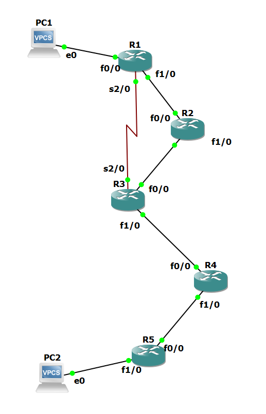
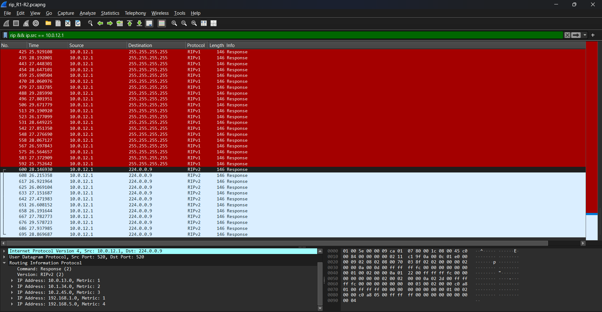

[English](README.md) | ภาษาไทย

# RIP: Hop Count, Convergence ที่ช้า, Routing Loop และ Count-to-Infinity (GNS3)

Lab นี้รัน RIP บน router ห้าตัวชุดเดียวกันและใช้ addressing เดียวกับ [OSPF lab](../ospf/) ของผม ทำให้ link เดิมล้มเหลวด้วยสามแบบเดิม เพื่อเทียบสองโปรโตคอลกันได้ตรง ๆ ส่วนสุดท้ายสร้าง routing loop จริง แล้ว capture ตอนที่ RIP นับไปจนถึง infinity

> Lab ทำคนเดียว สร้างใน GNS3 (ต.ค. 2026) Router: Cisco 7200, IOS 15.2 Host: VPCS

## Topology



| Link | Network | Address | ความเร็ว |
|---|---|---|---|
| PC1 – R1 f0/0 | 192.168.1.0/24 | PC1 .10, R1 .1 | 100 Mbps |
| R1 f1/0 – R2 f0/0 | 10.0.12.0/30 | R1 .1, R2 .2 | 100 Mbps |
| R2 f1/0 – R3 f0/0 | 10.0.23.0/30 | R2 .1, R3 .2 | 100 Mbps |
| R1 s2/0 – R3 s2/0 | 10.0.13.0/30 | R1 .1, R3 .2 | 1.544 Mbps |
| R3 f1/0 – R4 f0/0 | 10.1.34.0/30 | R3 .1, R4 .2 | 100 Mbps |
| R4 f1/0 – R5 f0/0 | 10.2.45.0/30 | R4 .1, R5 .2 | 100 Mbps |
| R5 f1/0 – PC2 | 192.168.5.0/24 | R5 .1, PC2 .10 | 100 Mbps |

## สรุปผล

| ส่วน | การทดสอบ | ผลลัพธ์ |
|---|---|---|
| 1 | RIPv1 แล้วตามด้วย RIPv2 | PC1 → PC2 ใช้งานได้ RIP ส่งผ่าน serial link 1.544 Mbps เพราะเส้นทางนั้นมี hop น้อยกว่าหนึ่ง hop |
| 2 | `offset-list` บน serial link | traffic ย้ายไปเส้นทาง FastEthernet แบบเดียวกับที่ OSPF เลือกเอง |
| 3 | link R1–R2 ล้มเหลว | RIP มี downtime 199 s ถึง 232 s ส่วน OSPF ใช้ 7 s ถึง 41 s กับความล้มเหลวแบบเดียวกัน |
| 4b | ปิด split horizon, RIPv2 | ไม่เกิด routing loop เพราะ field Next Hop ของ RIPv2 กันไว้ |
| 4c | ปิด split horizon, RIPv1 | เกิด routing loop ภายใน 5.5 s ping แต่ละครั้งวิ่งผ่าน link เดิม 60 รอบ |
| 5 | Count-to-infinity | R4 และ R5 เพิ่ม metric จาก 3 เป็น 16 ใน 13 ขั้น ภายใน 26.2 s |

### RIP เทียบกับ OSPF บน topology เดียวกัน ความล้มเหลวแบบเดียวกัน

| ความล้มเหลวของ link R1–R2 | OSPF | RIP |
|---|---|---|
| `shutdown` บน R1 | 7.06 s | 199.25 s |
| suspend link, interface ยัง up, timer ค่า default | 41.08 s | 232.30 s |
| suspend link, ปรับ timer | 11.06 s (Hello 1 s, Dead 4 s) | 32.08 s (`timers basic 5 15 15 30`) |

downtime คือช่วงห่างระหว่าง echo reply ตัวสุดท้ายก่อนเกิดความล้มเหลว กับตัวแรกหลังจากนั้น วัดจาก capture บน link ของ PC1

## 1. RIPv1 และ RIPv2

```
router rip
 network 10.0.0.0
 network 192.168.1.0        (R1; R5 uses 192.168.5.0)
 passive-interface FastEthernet0/0
```

ตัวอย่างบางส่วน:

```
R1#show ip route rip
R        10.0.23.0/30 [120/1] via 10.0.13.2, 00:00:24, Serial2/0
                      [120/1] via 10.0.12.2, 00:00:19, FastEthernet1/0
R        10.1.34.0/30 [120/1] via 10.0.13.2, 00:00:24, Serial2/0
R        10.2.45.0/30 [120/2] via 10.0.13.2, 00:00:24, Serial2/0
R     192.168.5.0/24 [120/3] via 10.0.13.2, 00:00:24, Serial2/0
```

**RIP เลือก link ที่ช้า** จาก R1 network ของ PC2 อยู่ห่าง 3 hop ถ้าไปทาง serial link และ 4 hop ถ้าไปผ่าน R2 RIP จึงติดตั้งเส้นทาง 3 hop และ `trace` จาก PC1 แสดง 5 บรรทัดผ่าน 10.0.13.2 ส่วน OSPF บน router ชุดเดียวกันเลือกเส้นทางผ่าน R2 (cost 5 เทียบกับ 67) เพราะรู้ว่า serial link ช้ากว่าประมาณ 65 เท่า

**hop count เท่ากันได้สองเส้นทาง** 10.0.23.0/30 อยู่ห่างหนึ่ง hop ทั้งทาง R2 และทาง R3 R1 จึงติดตั้ง next hop ทั้งสองตัว

**สิ่งที่เปลี่ยนเมื่อใช้ version 2** (`version 2`, `no auto-summary`):

| | RIPv1 | RIPv2 |
|---|---|---|
| `show ip protocols` | send version 1, receive any version | send version 2, receive version 2 |
| ปลายทางของ update | 255.255.255.255 | 224.0.0.9 |
| รายการใน `debug ip rip` | `subnet 10.0.13.0 metric 1` | `10.0.13.0/30 via 0.0.0.0, metric 1, tag 0` |
| field Netmask ใน capture | 0.0.0.0 | 255.255.255.252 |
| Transport | UDP 520 → 520 | UDP 520 → 520 |

ใน lab นี้ RIPv1 ยังใช้งานได้ เพราะทุก subnet ของ 10.0.0.0/8 ใช้ mask /30 เหมือนกัน ผมเปลี่ยน router เป็น version 2 ทีละตัว และไม่มี route หายเลย



**update ไม่ได้ห่างกัน 30 s พอดี** วัดแยกทีละ router จาก capture: RIPv1 อยู่ที่ 25.5 s ถึง 30.2 s (เฉลี่ย 27.6 s) และ RIPv2 อยู่ที่ 26.1 s ถึง 29.6 s (เฉลี่ย 27.4 s) IOS ลดช่วงเวลาลงแบบสุ่ม เพื่อไม่ให้ router ส่งพร้อมกัน

**เห็น split horizon ได้ตั้งแต่ตรงนี้** R1 ประกาศ 2 route บน serial link และ 5 route บน FastEthernet1/0 route ที่เรียนรู้มาจาก serial link จะไม่ถูกส่งกลับออกไปทางเดิม

### ข่าวดีไปเร็ว ข่าวร้ายไปช้า

ผมลบ RIP ออกจาก R5 ด้วย `no router rip` แล้วเพิ่มกลับเข้าไป เวลาในตารางมาจาก capture บน link R1–R2

| เวลา | เหตุการณ์ |
|---|---|
| 756.86 s | R1 และ R2 ประกาศ 192.168.5.0 ด้วย metric 16 |
| 832 s ถึง 838 s | 192.168.5.0 หายไปจาก update |
| 896.54 s | RIP กลับมาบน R5 แล้ว R2 และ R1 ประกาศ 192.168.5.0 อีกครั้ง ห่างกัน 0.04 s |

`no router rip` ไม่ส่งอะไรออกไปเลย R4 ต้องไม่ได้รับ update จาก R5 จนครบ Invalid timer 180 s ก่อน จึงจะถือว่า route ตายแล้ว ขากลับเร็วเกินกว่าที่ผมจะจับเวลาด้วยมือได้ เพราะ router ส่ง flash update ทันทีที่ตารางเปลี่ยน โดยไม่รอรอบ 30 s ใน capture สังเกต flash update ได้ง่าย คือมี route เดียว และมาถึงนอกรอบปกติ

ไฟล์: [`configs/1_ripv2/`](configs/1_ripv2/), [`outputs/00_base.txt`](outputs/00_base.txt), [`outputs/01_ripv1.txt`](outputs/01_ripv1.txt), [`outputs/02_ripv2.txt`](outputs/02_ripv2.txt), [`pcaps/01_ripv1_ripv2_R1-R2.pcapng`](pcaps/01_ripv1_ripv2_R1-R2.pcapng)

## 2. ทำให้ RIP เลี่ยง link ที่ช้า

```
R1#show int s2/0 | include BW
  MTU 1500 bytes, BW 1544 Kbit/sec, DLY 20000 usec,
R1#show int f1/0 | include BW
  MTU 1500 bytes, BW 100000 Kbit/sec, DLY 100 usec,
```

RIP ไม่ดูค่าเหล่านี้ เพื่อย้าย traffic ออกจาก serial link ผมบวก 2 เข้าไปใน metric ของทุก route ที่เรียนรู้มาทาง link นี้ ทำทั้งสองฝั่ง:

```
router rip
 offset-list 0 in 2 Serial2/0
```

| | ก่อน | หลัง |
|---|---|---|
| R1 → 192.168.5.0/24 | metric 3 via 10.0.13.2, Serial2/0 | metric 4 via 10.0.12.2, FastEthernet1/0 |
| R3 → 192.168.1.0/24 | metric 1 via 10.0.13.1, Serial2/0 | metric 2 via 10.0.23.1, FastEthernet0/0 |
| R1 → 10.0.23.0/30 | next hop สองตัว | via 10.0.12.2 เท่านั้น |
| `trace` PC1 → PC2 | 5 บรรทัด ผ่าน serial link | 6 บรรทัด ผ่าน R2 |

offset ต้องเป็น 2 เส้นทาง serial มีค่า 3 hop และเส้นทางผ่าน R2 มีค่า 4 hop ถ้าใช้ offset 1 จะแค่ทำให้เท่ากัน และต้องตั้งบน router ทั้งสองตัว ไม่อย่างนั้นสองทิศทางจะใช้เส้นทางต่างกัน

ตอนนี้ serial link กลายเป็นเส้นสำรอง เหมือนใน OSPF lab OSPF ไปถึงจุดนี้ได้จาก bandwidth ของ interface อย่างเดียว แต่กับ RIP ผมต้องคำนวณ metric ของทุกเส้นทางเอง

ไฟล์: [`configs/2_offset_list/`](configs/2_offset_list/), [`outputs/03_offset_list.txt`](outputs/03_offset_list.txt)

## 3. Link failure

PC1 ping PC2 ต่อเนื่องระหว่างที่ link R1–R2 ล้มเหลว เปิด capture ไว้บน link ของ PC1 และบน serial link

### 3a. `shutdown` บน R1 FastEthernet1/0: 199.25 s

ping หาย 101 ครั้ง: R1 ตอบกลับ "Destination host unreachable" 4 ครั้ง ที่เหลือเป็น timeout 97 ครั้ง

| เวลาหลัง shutdown | เหตุการณ์ | หลักฐาน |
|---|---|---|
| 0 s | R1 ลบทุก route ที่ผ่าน R2 | `RT: del 192.168.5.0 via 10.0.12.2, rip metric [120/4]` |
| 2 s | R1 ประกาศ route เหล่านั้นด้วย metric 16 บน serial link | capture บน serial |
| 4.5 s | R1 เรียนรู้เส้นทาง serial จาก periodic update รอบถัดไปของ R3 | `RT: add 192.168.5.0/24 via 10.0.13.2, rip metric [120/5]` |
| 4.5 s ถึง 199 s | echo request 97 ตัววิ่งผ่าน serial link แต่ไม่มี reply กลับมา | capture บน serial |
| ประมาณ 181 s | R2 เลิกใช้ route ไป 192.168.1.0 | `RT: no routes to 192.168.1.0, entering holddown` |
| ประมาณ 193 s | R3 เรียนรู้ 192.168.1.0 ผ่าน serial link | `RT: add 192.168.1.0/24 via 10.0.13.1, rip metric [120/3]` |
| 199 s | echo reply ตัวแรก | capture บน PC1 |

**ขาไปกลับมาใช้ได้ใน 4.5 s แต่ขากลับใช้เวลากว่า 3 นาที** คำสั่ง `shutdown` ทำบน R1 interface ของ R2 ยัง up อยู่ และ RIP ไม่มี Hello R2 จึงไม่มีทางรู้ ตลอด Invalid timer 180 s R2 ยังเก็บ route ปกติไปยัง network ของ PC1 ผ่าน link ที่ตายแล้ว และยังประกาศ route นี้ให้ R3:

```
R2#show ip route 192.168.1.0
  Known via "rip", distance 120, metric 1
  Last update from 10.0.12.1 on FastEthernet0/0, 00:02:45 ago
```

R3 เชื่อ R2 (metric 2) มากกว่าเส้นทาง serial (metric 3) reply จาก PC2 จึงถูกส่งไปที่ R2 แล้วหายไปที่นั่น

**ทำไม OSPF ใช้แค่ 7 s** LSA ใหม่ของ R1 บอกว่า "ฉันไม่มี link ไปหา R2 แล้ว" router ทุกตัวตัด link นั้นทิ้งทันที เพราะ OSPF จะใช้ link ก็ต่อเมื่อปลายทั้งสองฝั่งประกาศ link นั้น ส่วน RIP บอกได้แค่ว่า "ฉันไปถึง network เหล่านี้ไม่ได้" มันบอก R3 ไม่ได้ว่า route ของ R2 เก่าแล้ว

การที่ R1 กลับมาได้เองใน 4.5 s ส่วนหนึ่งเป็นเพราะโชค RIP เก็บไว้แค่ route ที่ดีที่สุด R1 จึงไม่มี route สำรองเก็บไว้ และต้องรอ periodic update รอบถัดไปของ R3 ซึ่งอาจนานถึง 30 s

### 3b. Suspend link, interface ยัง up: 232.30 s

ping หาย 115 ครั้ง ทั้งหมดเป็น timeout เวลาในตารางมาจาก capture บน serial link ถูก suspend ที่ประมาณ 9 s

| เวลา | เหตุการณ์ |
|---|---|
| 176.86 s | R3 ประกาศ 192.168.1.0 ด้วย metric 16 Invalid timer ของ R2 หมดแล้ว |
| 181.89 s | R1 ประกาศ 10.0.23.0, 10.1.34.0, 10.2.45.0 และ 192.168.5.0 ด้วย metric 16 Invalid timer ของ R1 หมดแล้ว |
| 187.66 s, 214.13 s | R3 เสนอ 192.168.5.0 ผ่าน serial link แต่ R1 ไม่รับ |
| 240.70 s | R3 เสนออีกครั้ง R1 รับ และ ping ใช้งานได้ |

หลัง Invalid timer หมด route ยังอยู่ในตารางของ R1 ในสถานะ holddown:

```
R     192.168.5.0/24 is possibly down, routing via 10.0.12.2, FastEthernet1/0
```

ระหว่าง holddown R1 ปฏิเสธ route ที่มี metric แย่กว่า (5 ผ่าน serial link เทียบกับ 4 เดิม) เพราะอาจเป็นข้อมูลเก่าที่วนกลับมา log ของ R1 แสดง `entering holddown` ตามด้วย `delete network route` อีก 60.0 s ต่อมา แล้วจึงได้ route ใหม่หลังจากนั้น 17 s ค่า holddown ที่ตั้งไว้คือ 180 s แต่ route ถูกลบเมื่อ Flush timer (240 s) หมด holddown จึงกินเวลาจริง 60 s

ในการทดสอบนี้ไม่มี "unreachable" เลย R1 มี route อยู่ในตารางตลอด และส่ง packet เข้า link ที่ตายแล้วต่อไปเรื่อย ๆ

การทดสอบนี้รันสองครั้ง เพราะครั้งแรกผมลืมเริ่ม capture ผล ping และ capture มาจากครั้งที่สอง ส่วนผล `debug ip routing` มาจากครั้งแรก

### 3c. ความล้มเหลวแบบเดียวกัน แต่ใช้ `timers basic 5 15 15 30`: 32.08 s

ping หาย 16 ครั้ง update ห่างกัน 4.3 s ถึง 4.9 s ลำดับเหตุการณ์เหมือน 3b แค่สั้นลง: `entering holddown` ประมาณ 21 s หลังเกิดความล้มเหลว R3 เสนอมาสองครั้งแต่ถูกปฏิเสธ route ถูกลบในอีก 10.0 s ต่อมา และ route ผ่าน serial ถูกติดตั้งหลังจากนั้นหนึ่งวินาที

สิ่งที่ต้องแลกคือ update packet เพิ่มขึ้นประมาณหกเท่า แต่ละตัวมี routing table ทั้งตาราง และ CPU ทำงานหนักขึ้น Invalid timer 15 s เท่ากับพลาด update แค่สามครั้ง ถ้า packet หายเป็นช่วงสั้น ๆ route ที่ยังดีอยู่ก็จะถูกลบ router ทุกตัวต้องใช้ timer ค่าเดียวกัน และต่อให้ปรับแล้ว RIP ก็ยังช้ากว่า OSPF แบบไม่ปรับอะไรตอนเจอ `shutdown`

ไฟล์: [`outputs/04_failover_shutdown.txt`](outputs/04_failover_shutdown.txt), [`outputs/05_failover_silent.txt`](outputs/05_failover_silent.txt), [`outputs/06_failover_tuned_timers.txt`](outputs/06_failover_tuned_timers.txt) และ capture สองไฟล์ต่อการทดสอบใน [`pcaps/`](pcaps/): `*_pc1.pcapng` สำหรับ ping และ `*_serial.pcapng` สำหรับ RIP update และ traffic ที่ถูก reroute

## 4. Split horizon และ routing loop

network ที่ล้มเหลวคือ LAN ของ PC2 คือ 192.168.5.0/24 บน R5 ในแต่ละการทดสอบ R5 จะหยุดส่ง update ก่อน (`passive-interface FastEthernet0/0`) แล้วจึง shutdown interface ฝั่ง LAN วิธีนี้ใช้จำลอง update ที่หายไป: network หายไปแล้ว แต่ R4 ยังไม่รู้

### 4a. เปิด split horizon: ไม่เกิด loop

```
R4#show ip interface f1/0 | include Split
  Split horizon is enabled
```

update ของ R4 ที่ส่งไปหา R5 มี 5 route ไม่มี 192.168.5.0 อยู่ด้วย เพราะ R4 เรียนรู้ route นี้มาจากทิศทางนั้น หลัง LAN ล้มเหลว R5 ไม่มี route (`% Network not in table`) และตอบ PC1 ด้วยข้อความ "Destination host unreachable" 64 ครั้ง นี่คือผลที่ถูกต้อง network หายไปแล้ว และ R5 ก็บอกแบบนั้น

### 4b. ปิด split horizon, RIPv2: ยังไม่เกิด loop

```
interface FastEthernet1/0        (R4; FastEthernet0/0 on R5)
 no ip split-horizon
router rip
 timers basic 30 180 0 240
```

ตอนนี้ R4 ประกาศ 192.168.5.0 กลับไปให้ R5 ผมคาดว่า R5 จะรับ route นี้เมื่อ LAN ของตัวเองล่ม แต่ไม่รับ `show ip route 192.168.5.0` บน R5 ได้ผล `% Network not in table` มากกว่า 20 ครั้ง และ PC1 ได้รับข้อความ "unreachable" จาก R5 144 ครั้ง

เหตุผลอยู่ใน update ของ R4:

```
  10.2.45.0/30 via 0.0.0.0, metric 1, tag 0
  192.168.5.0/24 via 10.2.45.2, metric 2, tag 0
```

RIPv2 มี field Next Hop ในทุก route ปกติค่าจะเป็น 0.0.0.0 หมายถึง "ส่งมาที่ฉัน" แต่สำหรับ 192.168.5.0 R4 ใส่ 10.2.45.2 ซึ่งเป็น address ของ R5 เอง capture แสดงค่านี้ในทุก update R5 ถูกบอกให้ไปหา network นี้ผ่านตัวเอง จึงทิ้ง route นั้นไป

ใน 4a ฝั่งผู้ส่งเป็นคนกัน route ไว้ ส่วนใน 4b ฝั่งผู้รับเป็นคนทิ้ง ประมาณ 185 s หลัง update ตัวสุดท้ายของ R5 Invalid timer ของ R4 หมด และ R4 ประกาศ metric 16

### 4c. ปิด split horizon, RIPv1: เกิด routing loop

RIPv1 ไม่มี field Next Hop ผมตั้ง version 1 เฉพาะบน link R4–R5:

```
interface FastEthernet1/0        (R4; FastEthernet0/0 on R5)
 ip rip send version 1
 ip rip receive version 1
```

ตอนนี้ update ของ R4 มี `network 192.168.5.0 metric 2` โดยไม่มี next hop 5.5 s หลัง LAN ล่ม:

```
R5: RT: add 192.168.5.0/24 via 10.2.45.1, rip metric [120/2]
R4: Known via "rip", distance 120, metric 1 ... via 10.2.45.2
```

R5 ชี้ไปที่ R4 และ R4 ชี้ไปที่ R5 สำหรับ network ที่ไม่มีอยู่แล้ว

```
PC1> ping 192.168.5.10 -t
*10.2.45.1 icmp_seq=46 ttl=252 time=361.445 ms (ICMP type:11, code:0, TTL expired in transit)

PC1> trace 192.168.5.10
 4   10.1.34.2   60.843 ms  61.209 ms  61.664 ms
 5   10.2.45.2   80.665 ms  62.144 ms  50.324 ms
 6   10.2.45.1   50.750 ms  50.975 ms  59.992 ms
 7   10.2.45.2   72.273 ms  81.983 ms  72.133 ms
 8   10.2.45.1   71.281 ms  63.015 ms  70.745 ms
```

**ping ครั้งเดียวกลายเป็น 60 frame** ใน capture บน link R4–R5 echo request แต่ละตัววิ่งผ่าน link 60 รอบ TTL ลดจาก 60 เหลือ 1 ภายใน 0.3 s ถึง 0.5 s ping 59 ครั้งสร้าง frame 3,540 ตัว routing loop ไม่ได้แค่ทำให้ไปถึงปลายทางไม่ได้ แต่ยังคูณ traffic บน link ที่วนอยู่ และมีแค่ TTL ที่ทำให้มันหยุด

ถ้าปล่อยไว้ loop จะจบเมื่อ Invalid timer ของ R4 หมด ประมาณ 152 s หลังเริ่ม loop

ไฟล์: [`configs/3_no_split_horizon_ripv2/`](configs/3_no_split_horizon_ripv2/), [`configs/4_no_split_horizon_ripv1/`](configs/4_no_split_horizon_ripv1/), [`outputs/07_split_horizon.txt`](outputs/07_split_horizon.txt), [`outputs/08_loop_attempt_ripv2.txt`](outputs/08_loop_attempt_ripv2.txt), [`outputs/09_loop_ripv1.txt`](outputs/09_loop_ripv1.txt), [`pcaps/08_ripv2_R4-R5.pcapng`](pcaps/08_ripv2_R4-R5.pcapng), [`pcaps/09_loop_R4-R5.pcapng`](pcaps/09_loop_R4-R5.pcapng) และ capture `*_pc1.pcapng` ที่คู่กัน

## 5. Count-to-infinity

ขณะที่ loop จาก 4c ยังอยู่ ผมให้ R5 กลับมาส่ง update (`no passive-interface FastEthernet0/0`) ตอนนี้ R5 ประกาศ route ปลอมที่เรียนรู้มาจาก R4

metric ที่ประกาศสำหรับ 192.168.5.0 บน link R4–R5:

| ผู้ส่ง | Metric |
|---|---|
| R5 | 3, 5, 7, 9, 11, 13, 15 |
| R4 | 4, 6, 8, 10, 12, 14, 16 |

update แรก (metric 3) อยู่ที่ 132.37 s และตัวสุดท้าย (metric 16) อยู่ที่ 158.61 s: 13 ขั้นใน 26.2 s หลังจากตัวแรก แต่ละขั้นเป็น flash update ที่มี route เดียว ห่างจากตัวก่อนหน้าประมาณ 2 s

```
R4: RT: rip's 192.168.5.0/24 (via 10.2.45.2) metric changed from distance/metric [120/1] to [120/3]
R4: RT: rip's 192.168.5.0/24 (via 10.2.45.2) metric changed from distance/metric [120/3] to [120/5]
    ...
R4: RT: rip's 192.168.5.0/24 (via 10.2.45.2) metric changed from distance/metric [120/13] to [120/15]
R4: RT: del 192.168.5.0 via 10.2.45.2, rip metric [120/15]
```

R5 ถือ metric 2 และประกาศ 3 R4 ต้องเชื่อ next hop ของตัวเอง จึงขยับจาก 1 เป็น 3 และประกาศ 4 R5 ก็ต้องเชื่อ next hop ของตัวเอง ขยับเป็น 4 และประกาศ 5 ไม่มี router ตัวไหนรู้ว่า network หายไปแล้ว ทั้งคู่นับไปจนถึง 16 ซึ่ง RIP กำหนดให้เป็น unreachable เพื่อให้การนับแบบนี้จบได้

**สิ่งที่ PC1 เห็น:**

| ลำดับ | ข้อความ | จาก | ความหมาย |
|---|---|---|---|
| 1 | reply 28 ครั้ง | PC2 | ปกติ |
| 2 | 9 × host unreachable | 10.2.45.2 (R5) | LAN ล่ม และ R5 ยังไม่มี route |
| 3 | 50 × TTL expired in transit | 10.2.45.1 (R4) | loop ตลอดช่วงที่นับ |
| 4 | 3 × host unreachable | 10.0.23.2 (R3) | R4 ลบ route ไปแล้ว |
| 5 | 24 × host unreachable | 192.168.1.1 (R1) | metric 16 ไปถึง R1 แล้ว |

ต้นทางของข้อความ error ขยับกลับมาหา PC1 เรื่อย ๆ ตามที่ข่าวร้ายกระจายออกไป ทำให้รู้ว่า router ตัวไหนทิ้ง route ไปแล้ว โดยไม่ต้อง login เข้า router ตัวใดเลย ระหว่างที่นับ ping 51 ครั้งวิ่งผ่าน link R4–R5 ครั้งละ 60 รอบ

**ต้องมีสี่เงื่อนไขพร้อมกัน:**

1. ปิด split horizon ทั้งสองฝั่งของ link
2. ไม่มี field Next Hop ซึ่งก็คือ RIPv1
3. update ที่แจ้งความล้มเหลวมาไม่ถึง
4. neighbor ส่ง route เก่ากลับมาก่อนที่ Invalid timer ของตัวเองจะหมด

ใน lab ต้นฉบับของวิชาที่ใช้ router จริง มีการปิด split horizon และ holddown แล้วดึงสายออก แต่ไม่เกิดการนับเลย router เห็น interface down ทันที เงื่อนไขข้อ 3 และ 4 จึงขาดไป

ไฟล์: [`outputs/10_count_to_infinity.txt`](outputs/10_count_to_infinity.txt), [`pcaps/10_count_R4-R5.pcapng`](pcaps/10_count_R4-R5.pcapng)

## ปัญหาที่เจอ

**loop ไม่เกิดกับ RIPv2** ผมเสียการรันไปหนึ่งรอบเต็มเพื่อรอ route ที่ R5 ไม่เคยติดตั้ง บรรทัด `192.168.5.0/24 via 10.2.45.2` ใน debug output ของ R4 คือเบาะแส และ field Next Hop ใน capture ยืนยันเรื่องนี้ ดู 4b

**ครั้งแรกที่ลองทำ count-to-infinity ผมช้าเกินไป** ผมเก็บ output ของ `show` และ `trace` ระหว่าง loop แล้วค่อยคืน update ของ R5 หลังเกิดความล้มเหลว 5 นาที ตอนนั้น Invalid timer ของ R4 หมดไปแล้ว และไม่เหลือ route ให้นับ รอบที่สองผมอยู่ใน configuration mode บน R5 ตลอด เช็กตารางด้วย `do show ip route 192.168.5.0` และคืน update ภายใน 33 s หลังเกิดความล้มเหลว การทดสอบที่ขึ้นกับ timer ต้องเตรียมคำสั่งไว้ก่อนเริ่ม

**ผมอ่าน update interval ใน Wireshark ผิด** คอลัมน์ Time แสดงช่วงห่าง 4 s ถึง 24 s ระหว่าง RIP packet เพราะ update ของ R1 และ R2 ปนกัน เมื่อใช้ filter `rip && ip.src == 10.0.12.1` interval ของ router ตัวเดียวคือ 26 s ถึง 30 s

**นาฬิกาของ router ไม่ตรงกัน** timestamp ใน log ของ router สองตัวต่างกันเป็นนาที ผมเรียงเหตุการณ์ข้าม router ด้วยเวลาใน capture และใช้ log แค่ดูลำดับเหตุการณ์ภายใน router ตัวเดียว

**ผมโทษ timer ผิดตัว** ใน test 3a ตอนแรกผมอธิบาย outage 3 นาทีว่าเกิดจาก holddown แต่จริง ๆ แล้วคือ Invalid timer บน R2: เวลาจนกว่า router จะยอมรับว่า route ตายแล้ว holddown เริ่มหลังจากนั้น ใน test 3b holddown เพิ่มเวลาประมาณ 59 s แต่ใน test 3a ไม่เพิ่มเลย เพราะ R3 ได้รับ metric 16 จาก R2 ลบ route ทันที และใช้เส้นทาง serial ในอีก 12 s ต่อมา

**เรื่องหนึ่งที่ผมยังอธิบายไม่ได้** เมื่อใช้ `timers basic 5 15 15 30` route อยู่ในสถานะ "possibly down" นาน 10.0 s ถ้าคิดจาก Flush ลบ Invalid ควรได้ 15 s ผมรายงานค่าที่วัดได้

## โครงสร้าง Repository

```
rip/
  topology.png
  ripv1_ripv2_wireshark.png
  rip.gns3             GNS3 project file (no IOS image included)
  configs/
    1_ripv2/                    R1 to R5
    2_offset_list/              R1, R3
    3_no_split_horizon_ripv2/   R4, R5
    4_no_split_horizon_ripv1/   R4, R5
  outputs/             ping, trace, show and debug output, in test order
  pcaps/               captures, numbered like the outputs
```

output ของส่วนที่ 3 ถึง 5 มี log `debug ip routing` ยาว บรรทัดที่ยกมาข้างบนคือส่วนที่สำคัญ
