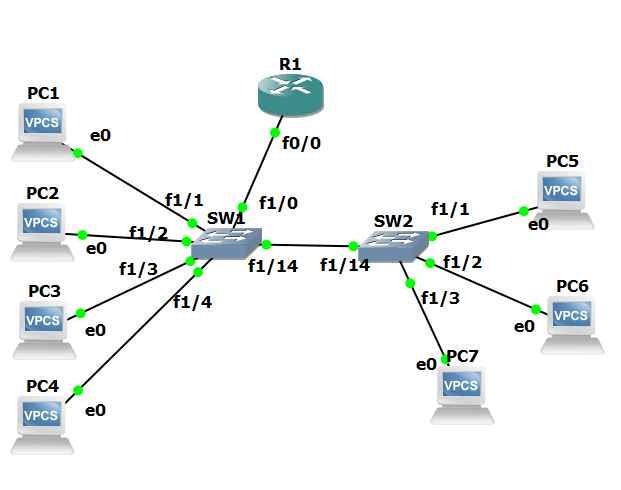
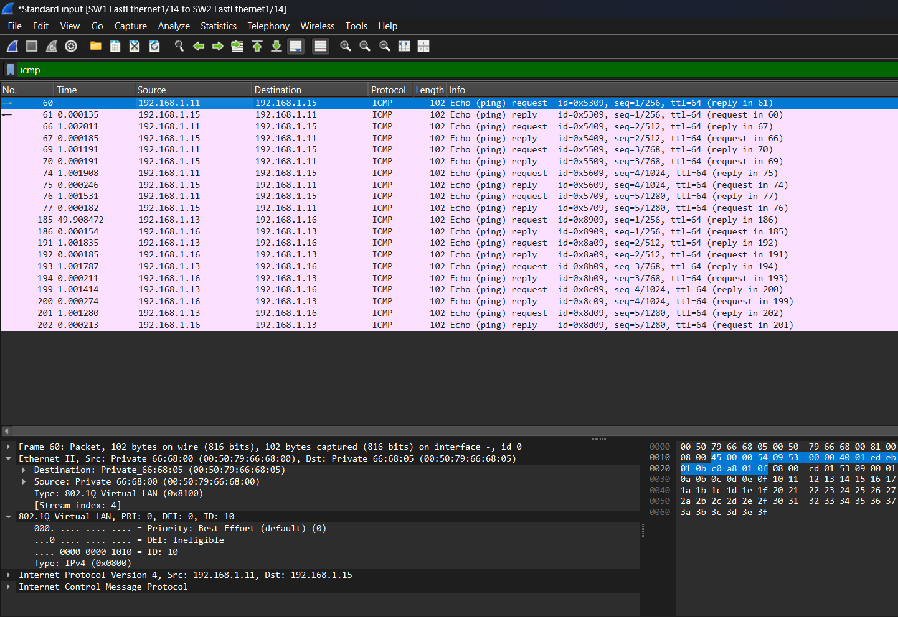

[English](README.md) | ภาษาไทย

# VLAN, 802.1Q Trunking และ Inter-VLAN Routing (GNS3)

Switch สองตัว host เจ็ดเครื่อง และ router หนึ่งตัว Lab นี้เริ่มจากเครือข่ายแบนเดียว แล้วแบ่งเป็น VLAN ส่ง VLAN ข้าม switch ผ่าน 802.1Q trunk ตั้งใจทำ trunk พังด้วย native VLAN mismatch จากนั้น route ระหว่าง VLAN ด้วย router-on-a-stick และด้วย switch virtual interface (SVI) ทุกขั้นตอนตรวจด้วยผล `show` และ Wireshark

> Lab ทำคนเดียว สร้างใน GNS3 (ต.ค. 2026) Switch: Cisco 3745 ที่ใส่ switch module NM-16ESW แบบ 16 port, IOS 12.4(25d) Router: Cisco 7200, IOS 15.2 Host: VPCS

## Topology



| VLAN | ชื่อ | Host | Part 1–2 (ใช้ subnet เดียวกันทั้งหมด) | Part 3 (หนึ่ง subnet ต่อหนึ่ง VLAN) |
|---|---|---|---|---|
| 10 | SALES | PC1, PC2 (SW1), PC5 (SW2) | 192.168.1.11, .12, .15 /24 | 192.168.10.0/24, gateway .1 |
| 20 | ENG | PC3, PC4 (SW1), PC6 (SW2) | 192.168.1.13, .14, .16 /24 | 192.168.20.0/24, gateway .1 |
| 30 | MGMT | PC7 (SW2) | – | 192.168.30.0/24, gateway .1 |
| 99 | NATIVE | ไม่มี | native VLAN ของทุก trunk ตั้งแต่ part 2e | native VLAN ของทุก trunk |

| Link | Mode |
|---|---|
| PC1–PC4 – SW1 Fa1/1 ถึง Fa1/4, PC5–PC7 – SW2 Fa1/1 ถึง Fa1/3 | access |
| SW1 Fa1/14 – SW2 Fa1/14 | trunk, 802.1Q, native 99 |
| SW1 Fa1/0 – R1 Fa0/0 | trunk, 802.1Q, native 99 |

ใน part 1 และ 2 ตั้งใจให้ทุก host อยู่ใน 192.168.1.0/24 ถ้า host สองเครื่องที่อยู่ subnet เดียวกันคุยกันไม่ได้ สิ่งที่แยกมันออกจากกันคือ VLAN ไม่ใช่ IP

## สรุปผล

| Part | การทดสอบ | ผลลัพธ์ |
|---|---|---|
| 1 | VLAN 10 และ 20 บน switch ตัวเดียว | PC1 → PC3 ไม่ผ่าน ทั้งที่อยู่ใน 192.168.1.0/24 ทั้งคู่ ARP broadcast ของ PC1 ไปถึง port ของ PC3 หนึ่งครั้งก่อนมี VLAN และศูนย์ครั้งหลังมี VLAN |
| 2a | Link สองเส้นระหว่าง switch อยู่ใน VLAN 1 ทั้งคู่ | STP block SW2 Fa1/15 path cost และ Bridge ID ของผู้ส่งเท่ากัน ตัดสินด้วย port ID ของผู้ส่ง |
| 2c | 802.1Q trunk เส้นเดียว | Echo request ตัวเดียวกันมีขนาด 102 bytes บน trunk และ 98 bytes บน access link ต่างกันที่ tag 4 bytes |
| 2e | Native VLAN 10 ฝั่งหนึ่ง 20 อีกฝั่ง | ไม่มี traffic รั่ว PVST+ ตรวจเจอ mismatch และ block VLAN 10 และ 20 บน trunk |
| 3a | Router-on-a-stick | ทุก VLAN ถึงกันได้ ping ข้าม VLAN หนึ่งครั้งทำให้มี 4 frame บน link ของ router เพราะแต่ละ packet วิ่งผ่าน link นี้สองรอบด้วย tag ต่างกัน |
| 3b | SVI บน SW1 | ถึงกันได้เหมือนเดิม และไม่มี ICMP บน link ของ router เลย |

## 1. VLAN บน switch ตัวเดียว

```
SW1# vlan database
SW1(vlan)# vlan 10 name SALES
SW1(vlan)# vlan 20 name ENG
SW1(vlan)# exit
APPLY completed.

interface range FastEthernet1/1 - 2
 switchport mode access
 switchport access vlan 10
interface range FastEthernet1/3 - 4
 switchport mode access
 switchport access vlan 20
```

| | ก่อนมี VLAN | หลังมี VLAN |
|---|---|---|
| PC1 → PC2 (VLAN 10 ทั้งคู่) | ตอบกลับ | ตอบกลับ |
| PC1 → PC3 (VLAN 10 → 20) | ตอบกลับ | `host (192.168.1.13) not reachable` |
| PC3 → PC4 (VLAN 20 ทั้งคู่) | – | ตอบกลับ |
| ARP ของ PC1 ที่ถาม PC2 ซึ่งเห็นบน link ของ PC3 | 1 frame | 0 frame (capture 192 s) |

**ทำไมได้ `host not reachable` ไม่ใช่ timeout** PC1 กับ PC3 อยู่ subnet เดียวกัน PC1 จึงส่ง ARP broadcast เพื่อถาม MAC address ของ PC3 Switch flood broadcast นี้ไปเฉพาะ port ใน VLAN 10 จึงไม่ถึง PC3 ไม่มีใครตอบ และ PC1 ไม่ได้ส่ง ICMP packet ออกไปเลย ส่วน timeout หมายถึง ICMP packet ออกไปแล้วแต่ไม่มี reply กลับมา ซึ่งจะเห็นใน part 3

Capture บน port ของ PC3 ยังเห็น STP BPDU ทุก 2 วินาที และ CDP frame ทุก 60 วินาที แม้ port นั้นต่อกับ PC อย่างเดียว หลังย้าย port ไป VLAN 20 Bridge ID ใน BPDU เปลี่ยนจาก `32768 / c4:01:07:b4:00:00` เป็น `32768 / c4:01:07:b4:00:02` แสดงว่า switch รัน STP แยกหนึ่ง instance ต่อหนึ่ง VLAN switch module นี้แยก instance ด้วยการใช้ MAC address คนละตัว ไม่ได้บวกเลข VLAN เข้าไปใน priority แบบ Catalyst รุ่นใหม่ (32768 + 20 = 32788)

## 2. VLAN ข้าม switch สองตัว

### 2a. Link สองเส้น อยู่ใน VLAN 1 ทั้งคู่: STP block หนึ่งเส้น

Link สองเส้นระหว่าง switch คู่เดียวกันใน VLAN เดียวกันทำให้เกิด loop

- **Root bridge:** SW1 เพราะ priority เท่ากัน (32768) และ MAC address ของ SW1 `c401.07b4.0002` ต่ำกว่าของ SW2 `c402.1ab6.0000`
- **SW2 Fa1/14:** root port, forwarding
- **SW2 Fa1/15:** blocking

SW2 เลือก root port โดยเทียบ link สองเส้นทีละขั้น:

| ขั้น | สิ่งที่เทียบ | Fa1/14 | Fa1/15 |
|---|---|---|---|
| 1 | Path cost ไปถึง root | 19 | 19 |
| 2 | Bridge ID ของผู้ส่ง | SW1 | SW1 |
| 3 | **Port ID ของผู้ส่ง** (port ของ SW1) | **128.55** | 128.56 |

ขั้นที่ 3 เป็นตัวตัดสิน ค่านี้มาจาก `Designated port id is 128.55` ใน `show spanning-tree` ของ SW2 เป็น port ID ฝั่ง SW1 ไม่ใช่ port ของ SW2 เอง

### 2b. Access link หนึ่งเส้นต่อหนึ่ง VLAN

ตั้ง Fa1/14 เป็น VLAN 10 และ Fa1/15 เป็น VLAN 20 บน switch ทั้งสองตัว ผลคือ PC1 ถึง PC5, PC3 ถึง PC6, PC1 ไปไม่ถึง PC6 และไม่มี port ถูก block เพราะแต่ละ VLAN มีทางเดียว ใช้งานได้ แต่ทุกครั้งที่เพิ่ม VLAN ต้องเพิ่มสายและ port อีกคู่

### 2c. 802.1Q trunk เส้นเดียว

```
interface FastEthernet1/14
 switchport trunk encapsulation dot1q
 switchport mode trunk
```



| Field | ค่า |
|---|---|
| Ethernet Type | `0x8100` (802.1Q) |
| Priority | 0 (Best Effort) |
| DEI | 0 |
| VLAN ID | 10 สำหรับ PC1 ↔ PC5, 20 สำหรับ PC3 ↔ PC6 |
| Type หลัง tag | `0x0800` (IPv4) |
| ความยาว frame ของ echo request ตัวเดียวกัน | **102 bytes บน trunk, 98 bytes บน access link ของ PC1** |

Control traffic บน trunk (native VLAN ยังเป็น 1):

| Frame | Destination | Tag | Bridge ID |
|---|---|---|---|
| STP ของ VLAN 1 แบบ IEEE | `01:80:c2:00:00:00` | ไม่มี | `c4:01:07:b4:00:02` |
| STP ของ VLAN 1 แบบ Cisco PVST+ | `01:00:0c:cc:cc:cd` | ไม่มี | `c4:01:07:b4:00:02` |
| STP ของ VLAN 10 | `01:00:0c:cc:cc:cd` | 10 | `c4:01:07:b4:00:00` |
| STP ของ VLAN 20 | `01:00:0c:cc:cc:cd` | 20 | `c4:01:07:b4:00:01` |
| CDP | `01:00:0c:cc:cc:cc` | ไม่มี | – |

STP instance ของแต่ละ VLAN ส่ง BPDU ของตัวเอง และติด tag ไว้ให้ switch อีกฝั่งรู้ว่าเป็นของ instance ไหน เห็นแต่ BPDU ของ SW1 เพราะ SW1 เป็น root ในทุก VLAN และ port trunk ของ SW2 เป็น root port ซึ่งรับ BPDU แต่ไม่ส่ง ไม่เห็น DTP frame เลย `show interfaces Fa1/14 switchport` แสดง `Negotiation of Trunking: Disabled`

### 2d. Allowed VLAN

```
SW1(config-if)# switchport trunk allowed vlan 1,10
Command rejected: Bad VLAN allowed list. You have to include all default vlans, e.g. 1-2,1002-1005.
SW1(config-if)# switchport trunk allowed vlan 1,10,1002-1005
```

Switch module นี้บังคับให้มี VLAN 1 และ 1002–1005 ใน list เมื่อเอา VLAN 20 ออกจาก trunk แล้ว PC3 → PC6 ไม่ผ่าน และ `show interfaces trunk` แสดง VLAN ที่ active แค่ VLAN 1 และ 10 สั่ง `switchport trunk allowed vlan 1-1005` แล้วกลับมาใช้ได้

### 2e. Native VLAN mismatch

ผมตั้ง native VLAN เป็น 10 ที่ฝั่ง SW1 ของ trunk และเป็น 20 ที่ฝั่ง SW2 เพื่อดูว่า frame VLAN 10 ที่ไม่มี tag จาก SW1 จะหลุดไปอยู่ใน VLAN 20 ของ SW2 หรือไม่

ผลคือไม่หลุด Switch log mismatch ทันทีที่เปลี่ยน native VLAN:

```
%SPANTREE-2-RECV_PVID_ERR: Received BPDU with inconsistent peer vlan id 1 on FastEthernet1/14 VLAN10.
%SPANTREE-2-BLOCK_PVID_PEER: Blocking FastEthernet1/14 on VLAN1. Inconsistent peer vlan.
%SPANTREE-2-BLOCK_PVID_LOCAL: Blocking FastEthernet1/14 on VLAN10. Inconsistent local vlan.
```

```
Port 55 (FastEthernet1/14) of VLAN10 is broken (Port VLAN ID Mismatch)
Port 55 (FastEthernet1/14) of VLAN20 is broken (Port VLAN ID Mismatch)
```

- มีแค่ VLAN 1 ที่ยังอยู่ในสถานะ forwarding บน trunk
- PC1 ไปไม่ถึงทั้ง PC5 และ PC6
- Capture บน trunk นาน 22 นาที ไม่มี ARP หรือ ICMP frame ที่ไม่มี tag เลย

**Switch รู้ได้อย่างไร** BPDU แบบ Cisco PVST+ ระบุ VLAN ที่ตัวเองเป็นเจ้าของไว้ข้างใน SW1 ส่ง BPDU ของ VLAN 10 แบบไม่มี tag เพราะ VLAN 10 เป็น native VLAN ของมัน SW2 เอา frame ที่ไม่มี tag เข้า native VLAN ของตัวเองคือ VLAN 20 แล้วอ่านเจอ VLAN 10 ใน BPDU จึง block port สำหรับ VLAN นั้น ถ้าเป็น switch ที่ไม่มีการตรวจนี้ frame ของ PC1 จะถูก forward เข้า VLAN 20

**วิธีแก้:** สร้าง VLAN 99 `NATIVE` บน switch ทั้งสองตัว และสั่ง `switchport trunk native vlan 99` ทั้งสองฝั่ง ไม่มี host อยู่ใน VLAN 99 frame ที่ไม่มี tag ซึ่งหลุดมาบน trunk จึงไม่ถึงใคร หลังแก้ BPDU ของ PVST+ สำหรับ VLAN 1 มี tag 1 และ BPDU ของ VLAN 99 เป็นตัวที่ไม่มี tag

## 3. Routing ระหว่าง VLAN

ตอนนี้แต่ละ VLAN มี subnet ของตัวเอง ต้องสร้าง VLAN 30 บน SW1 ด้วย แม้ไม่มี host อยู่ ไม่อย่างนั้น trunk ไปหา router จะไม่ส่ง VLAN นี้

### 3a. Router-on-a-stick

```
interface FastEthernet0/0.10
 encapsulation dot1Q 10
 ip address 192.168.10.1 255.255.255.0
interface FastEthernet0/0.20
 encapsulation dot1Q 20
 ip address 192.168.20.1 255.255.255.0
interface FastEthernet0/0.30
 encapsulation dot1Q 30
 ip address 192.168.30.1 255.255.255.0
interface FastEthernet0/0.99
 encapsulation dot1Q 99 native
```

`encapsulation dot1Q 10` ผูก subinterface กับ VLAN 10 คือรับ frame ที่มี tag 10 และติด tag 10 ให้ frame ที่ส่งออก Subnet ทั้งสามขึ้นใน `show ip route` เป็น connected route ไม่ต้องใช้ routing protocol

| PC1 ไปยัง | ผลลัพธ์ | TTL | Trace |
|---|---|---|---|
| 192.168.10.1 (gateway) | ตอบกลับ | 255 | – |
| PC2, VLAN เดียวกัน | ตอบกลับ | 64 | 1 hop |
| PC3 และ PC6, VLAN 20 | ตอบกลับ | 63 | 2 hops: 192.168.10.1 แล้วจึงถึง host |
| PC7, VLAN 30 บน SW2 | ตอบกลับ | 63 | – |
| 192.168.20.17, ไม่มี host นี้ | `timeout` | – | – |

**Echo request ตัวเดียว เห็นสองครั้งบน link ของ router:**

| | Frame 309 เข้า R1 | Frame 312 ออกจาก R1 |
|---|---|---|
| VLAN | 10 | 20 |
| Source MAC | PC1 `00:50:79:66:68:00` | R1 `ca:03:0a:0e:00:00` |
| Destination MAC | R1 `ca:03:0a:0e:00:00` | PC3 `00:50:79:66:68:02` |
| TTL | 64 | 63 |

IP address ไม่เปลี่ยน Router เปลี่ยน Ethernet header กับ tag และลด TTL ping ข้าม VLAN หนึ่งครั้ง (request และ reply) ทำให้มี 4 frame บน link ของ router ส่วน ping ภายใน VLAN 10 ไม่มีเลย Inter-VLAN traffic ทั้งหมดใช้ link นี้ร่วมกัน และวิ่งผ่านสองรอบ นี่คือจุดอ่อนของ router-on-a-stick

**ทำไมตรงนี้ได้ `timeout` แต่ part 1 ได้ `host not reachable`** ผมพิมพ์ address ของ PC7 ผิดเป็น 192.168.20.17 host นี้ไม่มีอยู่จริง แต่ผลที่ได้คือ timeout ไม่ใช่ `host not reachable`:

1. ปลายทางอยู่คนละ subnet PC1 จึง ARP หา gateway ได้คำตอบ แล้วส่ง ICMP packet ไปที่ R1
2. R1 ARP หา 192.168.20.17 ใน VLAN 20 capture เห็น request 6 ครั้งจาก 192.168.20.1 และไม่มีคำตอบ
3. R1 drop packet โดยไม่แจ้ง PC1
4. PC1 ส่ง packet ออกไปแล้ว และรอโดยไม่ได้อะไรกลับมา

`host not reachable` หมายความว่า ARP ของ host เองล้มเหลว ปัญหาจึงอยู่ใน subnet ของมันเอง ส่วน timeout หมายความว่า packet ออกไปแล้ว และปัญหาอยู่ไกลออกไปตามเส้นทาง

### 3b. Routing บน switch (SVI)

ปิด Fa0/0 ของ R1:

```
ip routing
interface Vlan10
 ip address 192.168.10.1 255.255.255.0
interface Vlan20
 ip address 192.168.20.1 255.255.255.0
interface Vlan30
 ip address 192.168.30.1 255.255.255.0
```

Gateway address เหมือนเดิม จึงไม่ต้องแก้อะไรที่ PC Ping ข้าม VLAN ยังใช้ได้ ได้ TTL 63 และ trace 2 hops และ capture บน link ของ router ไม่มี ICMP เลย มีแค่ ARP ที่ถูก flood และ BPDU SW1 route ระหว่าง VLAN ของตัวเอง Response time ใกล้เคียงกับ router-on-a-stick เพราะทั้งคู่เป็น router จำลองใน GNS3 Capture บอกได้ว่า traffic วิ่งไปทางไหน แต่บอกไม่ได้ว่า hardware จริงจะเร็วแค่ไหน

## หมายเหตุเรื่อง switch จำลอง

GNS3 ไม่มี image ของ Catalyst switch สำหรับ Dynamips จึงใช้ router Cisco 3745 ที่ใส่ switch module NM-16ESW เป็น switch สำหรับ lab นี้มันทำงานเหมือน Catalyst switch แต่มีจุดต่างดังนี้:

| งาน | Catalyst | NM-16ESW |
|---|---|---|
| สร้าง VLAN | `vlan 10` ใน global config | `vlan database` แล้ว `vlan 10 name SALES` แล้ว `exit` |
| ดู VLAN | `show vlan brief` | `show vlan-switch brief` |
| Allowed VLAN บน trunk | ใส่ list อะไรก็ได้ | ต้องมี 1 และ 1002–1005 |
| STP Bridge ID ต่อ VLAN | priority + เลข VLAN | MAC address แยกต่อ VLAN กำหนดตามลำดับที่ instance เริ่มทำงาน |

ข้อจำกัดของ emulator ที่เจอ:

- VLAN เก็บใน `vlan.dat` ไม่ได้อยู่ใน running-config และหายไปเมื่อปิด project ใน GNS3 แต่ config ของ port ยังอยู่ port จึงค้างอยู่ใน VLAN ที่ไม่มีแล้ว วาง [`configs/vlan_database.txt`](configs/vlan_database.txt) ทุกครั้งหลังเริ่มรัน ทุกอย่างก็กลับมา
- `show mac-address-table` แสดงแค่ entry ของ VLAN 1 (เช่น MAC address ของ R1 บน Fa1/0) ไม่เคยแสดง host ใน VLAN 10, 20 หรือ 30 แม้ forwarding ใช้งานได้
- ลบ link ใน GNS3 แล้ว port ของ switch ไม่ down `show spanning-tree` ยังแสดง Fa1/15 เป็น forwarding หลังถอดสายไปแล้ว ผมจึงสั่ง shutdown port แทน

## ปัญหาที่เจอ

| ปัญหา | สาเหตุและวิธีแก้ |
|---|---|
| ใช้ `end` ใน `vlan database` ไม่ได้ | ต้องใช้ `exit` เพื่อออกจาก mode นั้นและ apply การเปลี่ยนแปลง |
| `switchport trunk allowed vlan 1,10` ถูก reject | List ต้องมี VLAN 1 และ 1002–1005 |
| VLAN หายหมดหลังเปิด project ใหม่ | GNS3 ไม่เก็บ `vlan.dat` ต้องวางคำสั่ง `vlan database` ใหม่ |
| Port ของ switch ยัง forwarding หลังลบ link ใน GNS3 | Port จำลองไม่ down ให้สั่ง `shutdown` ทั้งสองฝั่งแทน |

## โครงสร้าง repository

```
vlan-intervlan/
├── README.md
├── topology.png
├── vlan_tag_wireshark.png
├── vlan-intervlan.gns3
├── configs/
│   ├── vlan_database.txt         VLANs to paste after every start
│   ├── 1_one_switch/             SW1 (part 1)
│   ├── 2_trunk_native99/         SW1, SW2 (end of part 2)
│   └── 3_router_on_a_stick/      R1, SW1, SW2 (part 3a)
├── outputs/
│   ├── 00_base.txt
│   ├── 01_no_vlan.txt
│   ├── 02_vlan_one_switch.txt
│   ├── 03_two_links_vlan1.txt
│   ├── 04_access_link_per_vlan.txt
│   ├── 05_trunk_allowed_vlan.txt
│   ├── 06_native_vlan_mismatch.txt
│   ├── 07_router_on_a_stick.txt
│   └── 08_svi.txt
└── pcaps/
    ├── 01_no_vlan_pc3_link.pcapng
    ├── 02_vlan_pc3_link.pcapng
    ├── 05_trunk.pcapng
    ├── 05_access_pc1_link.pcapng
    ├── 06_native_mismatch_trunk.pcapng
    ├── 07_router_on_a_stick_r1_link.pcapng
    └── 08_svi_r1_link.pcapng
```

ไฟล์ output คัดลอกมาจาก console ตรง ๆ คำสั่งที่พิมพ์ผิดและคำสั่งที่ถูก reject ยังเก็บไว้ตามเดิม
